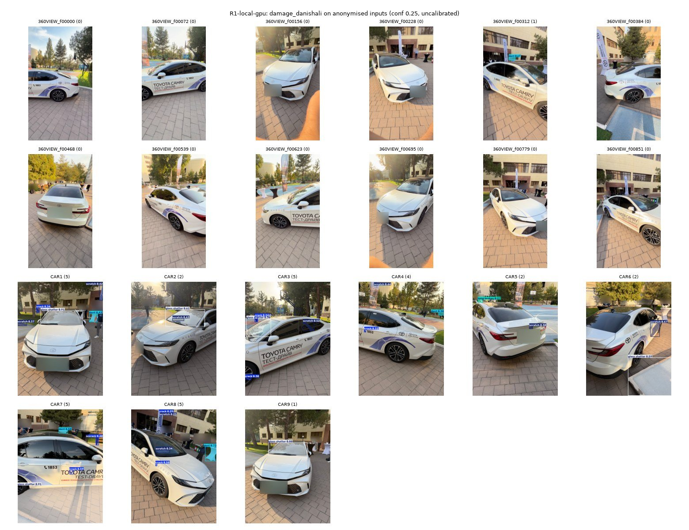
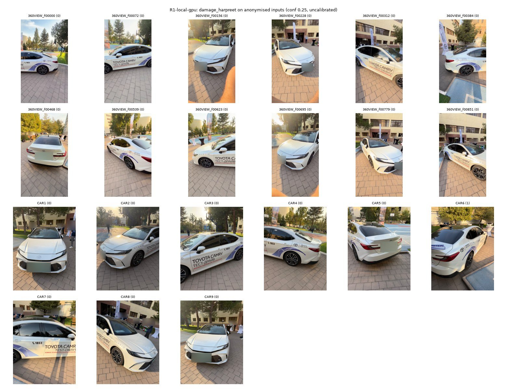
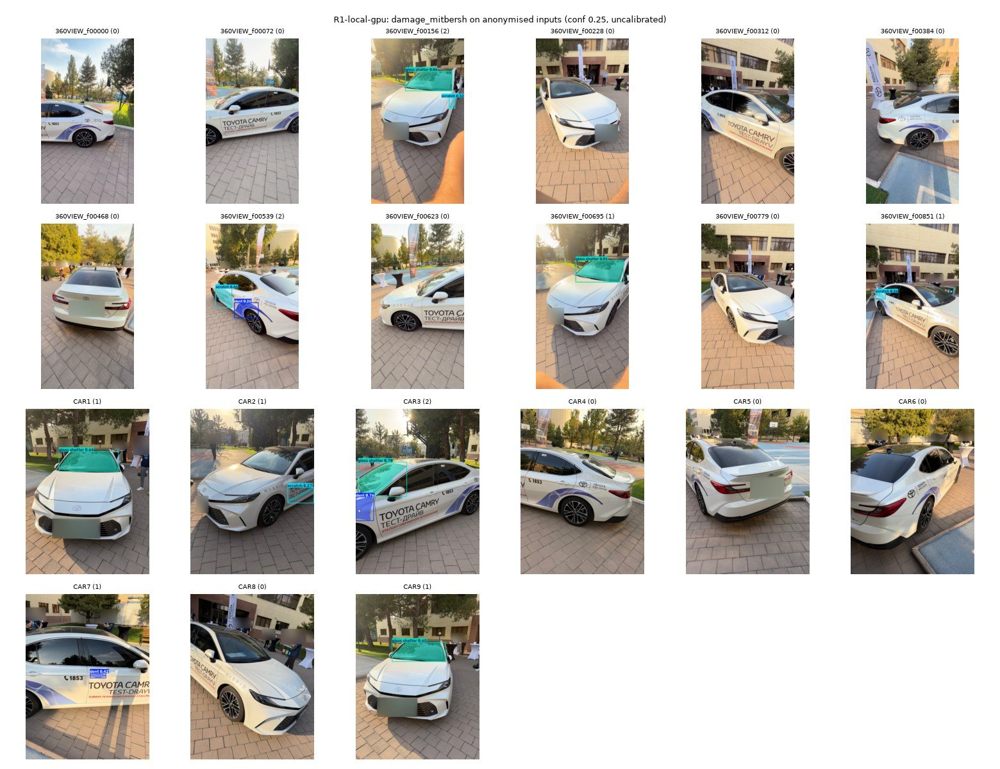
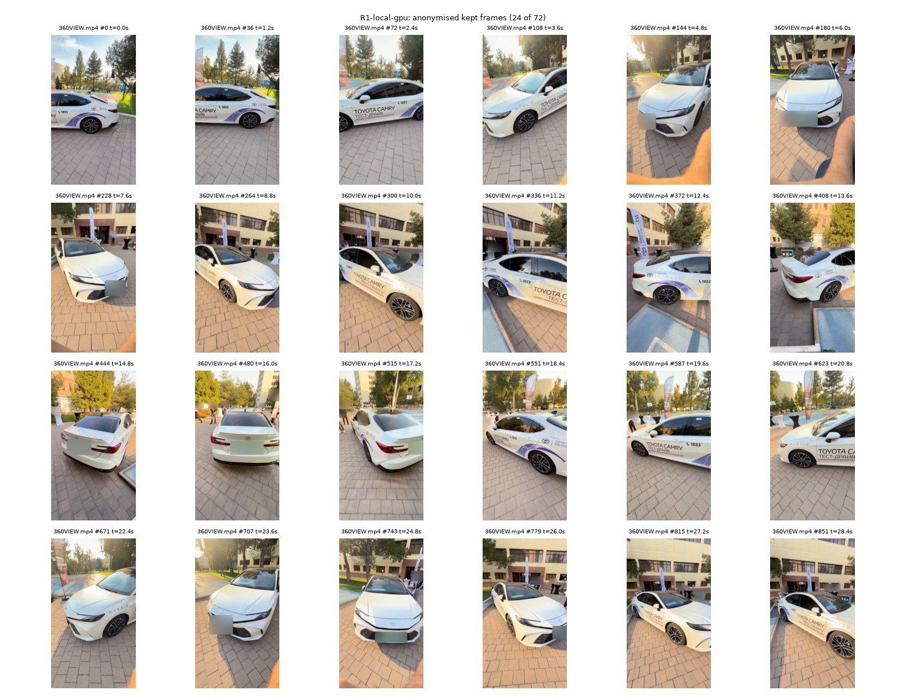
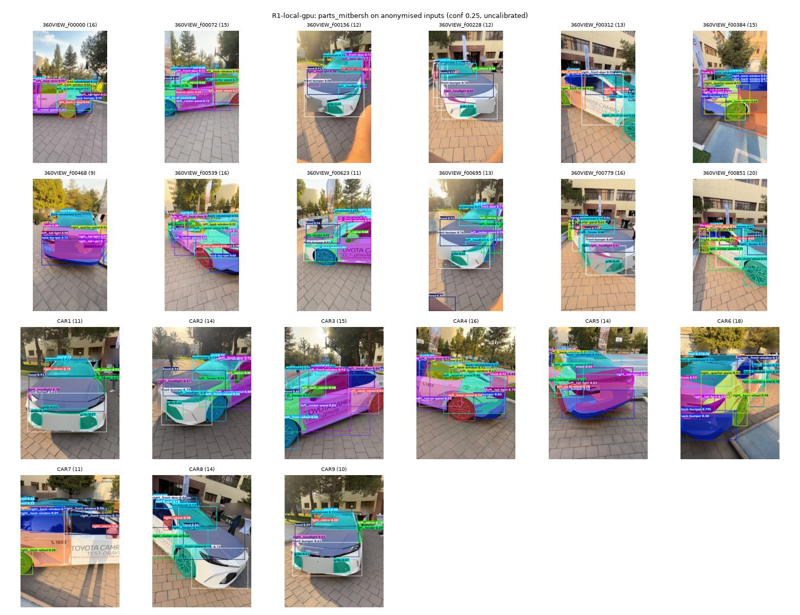

# Phase 1 smoke test results

<!-- Hand-written text lives outside the marker pairs. Everything between a BEGIN/END marker pair is generated
by scripts/render_results.py from outputs/smoke/<run>/ (gitignored): never edit it by hand, re-run the script.
`python scripts/render_results.py --check` exits 1 when the generated tables are stale. -->

## Purpose and pass condition

Phase 1 checks that the candidate models, the privacy step and the VIN reader work on our own media before any app code is written. From CLAUDE.md, section 3:

> ### Phase 1 — Colab smoke test (`notebooks/01_smoke_test_colab.ipynb`)
> Must run top-to-bottom in Google Colab (GPU and CPU runtime):
> - Install cell, GPU check, load inputs from `data/raw/` (upload or Google Drive mount).
> - Extract frames from `data/raw/video/*` at 2–3 fps; quality filter (Laplacian blur variance, brightness).
> - Run every candidate damage model + parts model on the frames and the photos in `data/raw/images/`; save annotated outputs to `outputs/` (gitignored).
> - OCR on `data/raw/vin/*`, validate, decode.
> - Print per-frame latency on CPU and GPU.
>
> Pass condition: annotated images look sensible, VIN read correctly or failure understood, latencies recorded in `docs/research/smoke_test_results.md`.

User-approved deviations that apply here:

- The notebook is executed locally on the RTX 5050 laptop (GPU and CPU). The Colab runs are a user step.
- RapidOCR replaces PaddleOCR. EasyOCR runs as the comparison.
- SAM 3 is dropped.
- The parts model is the pretrained `mitbersh/car-parts-segmentation`.
- Deploy CPU latency is a pinned 2-thread local proxy, labelled optimistic.

Privacy rule for every run: no pixels are displayed or saved before anonymisation. Plates and faces are pixelated and the step fails closed, so an input whose detectors fail is dropped. `outputs/` is gitignored, and only anonymised contact sheets are copied to `docs/assets/smoke/`. VINs are masked after position 11 in everything the runs write and in this file.

## Hardware and software disclosure

The notebook's environment cell records the machine and library versions of every run (`env.json`, or `env` in `results.json`). Latency rows also record the 1-minute load average. The ONNX Runtime rows record the CPU affinity in force and the number of physical cores it spans.

<!-- BEGIN:runs_env -->
<!-- generated by scripts/render_results.py from outputs/smoke/; do not edit by hand -->
Run status:

| run | results.json | latency rows | estimate rows | errors | first errors | unreadable files |
| --- | --- | ---: | ---: | ---: | --- | --- |
| R1-local-gpu | yes | 5 | 22 | 0 |  |  |
| R2-local-cpu | yes | 17 | 48 | 0 |  |  |

_measured: R1-local-gpu, R2-local-cpu, source_ `outputs/smoke/<run>/`

Hardware and software:

| field | R1-local-gpu | R2-local-cpu |
| --- | --- | --- |
| platform | Linux-7.0.0-38-generic-x86_64-with-glibc2.43 | Linux-7.0.0-38-generic-x86_64-with-glibc2.43 |
| colab | no | no |
| versions.python | 3.12.15 | 3.12.15 |
| versions.torch | 2.14.1+cu130 | 2.14.1+cu130 |
| versions.torchvision | 0.29.1+cu130 | 0.29.1+cu130 |
| versions.ultralytics | 8.4.175 | 8.4.175 |
| versions.onnxruntime | 1.31.0 | 1.31.0 |
| versions.cv2 | 5.0.0 | 5.0.0 |
| versions.numpy | 2.5.3 | 2.5.3 |
| versions.rapidocr | 3.10.0 | 3.10.0 |
| gpu.device | cuda | cpu |
| gpu.cuda_available | yes | no |
| gpu.name | NVIDIA GeForce RTX 5050 Laptop GPU |  |
| gpu.capability | 12.0 |  |
| gpu.arch_supported | yes |  |
| gpu.torch_cuda | 13.0 |  |
| gpu.driver | 595.91.07 |  |
| gpu.memory_gb | 7.5 |  |
| cpu.model | AMD Ryzen 7 260 w/ Radeon 780M Graphics | AMD Ryzen 7 260 w/ Radeon 780M Graphics |
| cpu.count | 16 | 16 |
| cpu.loadavg | 4.63, 5.15, 4.03 | 3.36, 4.76, 3.98 |
| cpu.power_profile | performance | performance |
| cpu.mem_total | 31593504 kB | 31593504 kB |
| cpu.torch_threads | 8 | 8 |
| created_at | 2026-10-11T00:28:53+05:00 | 2026-10-11T00:30:07+05:00 |
| gpu.arch_list | sm_75, sm_80, sm_86, sm_90, sm_100, sm_120 |  |
| gpu.cudnn | 92400 |  |
| onnxruntime_distributions.onnxruntime | 1.31.0 | 1.31.0 |
| opencv_distributions.opencv-python-headless | 5.0.0.93 | 5.0.0.93 |
| run | R1-local-gpu | R2-local-cpu |
| ultralytics_autoinstall | no | no |
| yunet.faces_on_blank_frame | 0 | 0 |
| yunet.file | models/face/face_detection_yunet_2026may.onnx | models/face/face_detection_yunet_2026may.onnx |
| yunet.opencv_major | 5 | 5 |
| yunet.status | ok | ok |

_measured: R1-local-gpu, R2-local-cpu, source_ `outputs/smoke/<run>/results.json` (`env`)
<!-- END:runs_env -->

## Run matrix

| id | where | device | purpose |
|---|---|---|---|
| R0 | local laptop | `cpu` | Dry run with small input caps (`AVTO_MAX_FRAMES`, `AVTO_MAX_IMAGES`, `AVTO_MAX_VINS`). It checks that the notebook runs top to bottom and writes every output file. |
| R1 | local laptop, NVIDIA RTX 5050 Laptop GPU | `cuda` | Full run with every model, plus the `gpu` latency tier. |
| R2 | local laptop, CUDA hidden (`CUDA_VISIBLE_DEVICES=""`) | `cpu` | Full run on CPU, plus the `cpu_torch`, `cpu_ort16` and `cpu_ort2` latency tiers. |
| Colab GPU | Google Colab GPU runtime | `cuda` | User step: the same notebook on Colab. |
| Colab CPU | Google Colab CPU runtime | `cpu` | User step: the same notebook on a Colab CPU runtime. |

Each run writes to `outputs/smoke/<run>/`, with the run id taken from `AVTO_RUN`. A run that is missing from the generated tables has not been executed, or its outputs are not on this machine.

The generated tables round the values in the run files half up: milliseconds to 1 decimal, load averages to 2, and confidences, scores and IoU to 3. Counts are integers.

## Latency protocol

- **Inputs:** a fixed list of `AVTO_LAT_FRAMES` anonymised working frames, saved to `outputs/smoke/<run>/latency_frames/`, so every tier times the same images.
- **Runs:** each model and tier gets one untimed setup call (model or session load plus the first inference), then `AVTO_LAT_WARMUP` untimed warm-ups, then up to `AVTO_LAT_RUNS` timed single-image runs cycling the frames.
- **Cap:** the timed phase stops early once it has taken longer than `AVTO_LAT_CAP_S` seconds. The row then shows `cap hit` = yes, and `timed runs` says how many runs completed. The values used are in each row's protocol string.
- **Statistics:** median and p90 over the timed runs. p90 interpolates linearly between the closest ranks.
- **Tiers:**
  - `gpu`: PyTorch on CUDA, every loaded model (R1).
  - `cpu_torch`: PyTorch on CPU, in the notebook process (R2).
  - `cpu_ort16`: ONNX Runtime with 16 intra-op threads, unpinned (R2). It runs in its own process via `scripts/bench_cpu.py`.
  - `cpu_ort2`: ONNX Runtime with 2 intra-op threads, pinned with `taskset -c 0,8` via `scripts/bench_cpu.py`. On this laptop, CPUs 0 and 8 are the two hardware threads of one physical core.
- **The deploy proxy:** `cpu_ort2` stands in for deploy hardware and is labelled the **optimistic lower bound for HF CPU Basic (2 vCPU)**. It is not a measurement of Hugging Face hardware. The assumption, not measured, is that an idle laptop core is at least as fast as a shared 2-vCPU cloud slice, so deploy latency should be equal or higher.
- **Kinds** (the `kind` column, which is the first token of the protocol when that token is a measurement kind; rows that record a failed step, such as an ONNX export, leave it empty):
  - `e2e-ultralytics`: preprocess + inference + postprocess, from ultralytics `r.speed`. `infer median ms` is inference only, and `wall median ms` is the wall time of `predict()`.
  - `raw-ort`: ONNX Runtime `session.run` only, on a letterboxed float32 NCHW input. `wall median ms` adds the letterbox step.
- **Threads:** the ONNX Runtime tiers set intra-op = threads and inter-op = 1, including for the session ultralytics creates internally. `OMP_NUM_THREADS`, `OPENBLAS_NUM_THREADS` and `MKL_NUM_THREADS` are exported before numpy, OpenCV or torch is imported. Importing ultralytics makes OpenCV single-threaded (`cv2.setNumThreads(0)`), and its CPU device setup resets torch to `min(8, os.cpu_count() - 1)` threads, so `scripts/bench_cpu.py` sets torch back to the tier's thread count after the setup call (ultralytics 8.4.175, read in `ultralytics/utils/__init__.py` and `select_device`). Each bench row's protocol string records the ONNX Runtime, torch and OpenCV thread counts in force during the timed runs.
- **Pinning:** in bench rows, `pinned` = yes only when the process's CPU affinity really is restricted. The bench checks the caller's `--pinned 1` against the affinity, and records a mismatch in the protocol string.
- **ONNX files:** each deploy candidate is exported once per image size, to `models/onnx/<key>_<imgsz>.onnx`.
- **Load:** `load 1m` is the 1-minute load average sampled just before the timed phase. Read rows with a high value with care.

## Models

<!-- BEGIN:models -->
<!-- generated by scripts/render_results.py from outputs/smoke/; do not edit by hand -->
| run | model | status | role | task | imgsz | conf | iou | n_classes | size_bytes | sha256 | file | error | conf_source | licence_declared | reported_classes | sha256_ok | source |
| --- | --- | --- | --- | --- | ---: | ---: | ---: | ---: | ---: | --- | --- | --- | --- | --- | --- | --- | --- |
| R1-local-gpu | coco_yolo26n | ok | coco | detect | 640 | 0.250 | 0.700 | 80 | 5544453 | 9b09cc8bf347 | models/coco/yolo26n.pt |  | uncalibrated default | AGPL-3.0 | person, car, bus, truck | yes | https://github.com/ultralytics/assets/releases/download/v8.4.0/yolo26n.pt |
| R1-local-gpu | damage_danishali | ok | damage | segment | 640 | 0.250 | 0.700 | 6 | 63442309 | 671554b49b8d | models/damage/danishali_best.pt |  | uncalibrated default | card: Apache-2.0 (checkpoint metadata: AGPL-3.0) |  | yes | hf:Danishali273/Car-Damage-Type-Segmentation@12f084adf567d0870c8c487cef4e29fa27fd45ef |
| R1-local-gpu | damage_harpreet | ok | damage | segment | 1024 | 0.250 | 0.700 | 6 | 124885473 | ab7d4e440104 | models/damage/harpreet_best.pt |  | uncalibrated default | AGPL-3.0 (card) |  | yes | hf:harpreetsahota/car-dd-segmentation-yolov11@f455e7b592b64958e343f457de3d0ba2c79df884 |
| R1-local-gpu | damage_mitbersh | ok | damage | segment | 896 | 0.250 | 0.700 | 6 | 54504241 | 7c4a870b16bf | models/damage/mitbersh_damage_segmentation.pt |  | models/damage/mitbersh_damage_inference_config.json (uncalibrated) | none declared on HF (checkpoint metadata: AGPL-3.0) |  | yes | hf:mitbersh/car-damage-segmentation@3242b6c580e5f45fdb7b436c4296a78a16683a94 |
| R1-local-gpu | parts_mitbersh | ok | parts | segment | 768 | 0.250 | 0.700 | 33 | 23413021 | 92228a116cbd | models/parts/mitbersh_parts_segmentation.pt |  | models/parts/mitbersh_parts_inference_config.json (uncalibrated) | none declared on HF |  | yes | hf:mitbersh/car-parts-segmentation@05e58a396aefbe46d86ab9d17bbc945817163577 |
| R2-local-cpu | coco_yolo26n | ok | coco | detect | 640 | 0.250 | 0.700 | 80 | 5544453 | 9b09cc8bf347 | models/coco/yolo26n.pt |  | uncalibrated default | AGPL-3.0 | person, car, bus, truck | yes | https://github.com/ultralytics/assets/releases/download/v8.4.0/yolo26n.pt |
| R2-local-cpu | damage_danishali | ok | damage | segment | 640 | 0.250 | 0.700 | 6 | 63442309 | 671554b49b8d | models/damage/danishali_best.pt |  | uncalibrated default | card: Apache-2.0 (checkpoint metadata: AGPL-3.0) |  | yes | hf:Danishali273/Car-Damage-Type-Segmentation@12f084adf567d0870c8c487cef4e29fa27fd45ef |
| R2-local-cpu | damage_harpreet | ok | damage | segment | 1024 | 0.250 | 0.700 | 6 | 124885473 | ab7d4e440104 | models/damage/harpreet_best.pt |  | uncalibrated default | AGPL-3.0 (card) |  | yes | hf:harpreetsahota/car-dd-segmentation-yolov11@f455e7b592b64958e343f457de3d0ba2c79df884 |
| R2-local-cpu | damage_mitbersh | ok | damage | segment | 896 | 0.250 | 0.700 | 6 | 54504241 | 7c4a870b16bf | models/damage/mitbersh_damage_segmentation.pt |  | models/damage/mitbersh_damage_inference_config.json (uncalibrated) | none declared on HF (checkpoint metadata: AGPL-3.0) |  | yes | hf:mitbersh/car-damage-segmentation@3242b6c580e5f45fdb7b436c4296a78a16683a94 |
| R2-local-cpu | parts_mitbersh | ok | parts | segment | 768 | 0.250 | 0.700 | 33 | 23413021 | 92228a116cbd | models/parts/mitbersh_parts_segmentation.pt |  | models/parts/mitbersh_parts_inference_config.json (uncalibrated) | none declared on HF |  | yes | hf:mitbersh/car-parts-segmentation@05e58a396aefbe46d86ab9d17bbc945817163577 |

_measured: R1-local-gpu, R2-local-cpu, source_ `outputs/smoke/<run>/results.json` (`models`); sha256 shows the first 12 hex chars

Runtime class names (`model.names`, index name):

- `coco_yolo26n` (R1-local-gpu, R2-local-cpu): 0 person, 1 bicycle, 2 car, 3 motorcycle, 4 airplane, 5 bus, 6 train, 7 truck, 8 boat, 9 traffic light, 10 fire hydrant, 11 stop sign, 12 parking meter, 13 bench, 14 bird, 15 cat, 16 dog, 17 horse, 18 sheep, 19 cow, 20 elephant, 21 bear, 22 zebra, 23 giraffe, 24 backpack, 25 umbrella, 26 handbag, 27 tie, 28 suitcase, 29 frisbee, 30 skis, 31 snowboard, 32 sports ball, 33 kite, 34 baseball bat, 35 baseball glove, 36 skateboard, 37 surfboard, 38 tennis racket, 39 bottle, 40 wine glass, 41 cup, 42 fork, 43 knife, 44 spoon, 45 bowl, 46 banana, 47 apple, 48 sandwich, 49 orange, 50 broccoli, 51 carrot, 52 hot dog, 53 pizza, 54 donut, 55 cake, 56 chair, 57 couch, 58 potted plant, 59 bed, 60 dining table, 61 toilet, 62 tv, 63 laptop, 64 mouse, 65 remote, 66 keyboard, 67 cell phone, 68 microwave, 69 oven, 70 toaster, 71 sink, 72 refrigerator, 73 book, 74 clock, 75 vase, 76 scissors, 77 teddy bear, 78 hair drier, 79 toothbrush
- `damage_danishali` (R1-local-gpu, R2-local-cpu): 0 crack, 1 dent, 2 glass shatter, 3 lamp broken, 4 scratch, 5 tire flat
- `damage_harpreet` (R1-local-gpu, R2-local-cpu): 0 crack, 1 dent, 2 glass shatter, 3 lamp broken, 4 scratch, 5 tire flat
- `damage_mitbersh` (R1-local-gpu, R2-local-cpu): 0 dent, 1 scratch, 2 crack, 3 glass shatter, 4 lamp broken, 5 tire flat
- `parts_mitbersh` (R1-local-gpu, R2-local-cpu): 0 back-bumper, 1 back-windshield, 2 front-bumper, 3 grille, 4 hood, 5 left_back-door, 6 left_back-wheel, 7 left_back-window, 8 left_fender, 9 left_front-door, 10 left_front-wheel, 11 left_front-window, 12 left_headlight, 13 left_mirror, 14 left_quarter-panel, 15 left_rocker-panel, 16 left_tail-light, 17 license-plate, 18 right_back-door, 19 right_back-wheel, 20 right_back-window, 21 right_fender, 22 right_front-door, 23 right_front-wheel, 24 right_front-window, 25 right_headlight, 26 right_mirror, 27 right_quarter-panel, 28 right_rocker-panel, 29 right_tail-light, 30 roof, 31 trunk, 32 windshield
<!-- END:models -->

## Detections

All thresholds are uncalibrated defaults; calibration happens in Phase 2. Detection counts say nothing about correctness. The visual check is G3 below.

<!-- BEGIN:detections -->
<!-- generated by scripts/render_results.py from outputs/smoke/; do not edit by hand -->
Inputs and frame quality filter (uncalibrated default thresholds):

| field | R1-local-gpu | R2-local-cpu |
| --- | --- | --- |
| counts.frames_blurred | 72 | 24 |
| counts.frames_dropped_privacy | 0 | 0 |
| counts.frames_kept | 72 | 24 |
| counts.frames_rejected | 0 | 0 |
| counts.frames_sampled | 72 | 24 |
| counts.model_inputs | 81 | 33 |
| counts.photos | 9 | 9 |
| counts.photos_blurred | 9 | 9 |
| counts.photos_dropped_privacy | 0 | 0 |
| counts.photos_load_failed | 0 | 0 |
| counts.videos | 1 | 1 |
| counts.vin_images | 3 | 3 |
| quality.n_frames | 72 | 24 |
| quality.n_ok | 72 | 24 |
| quality.thresholds.analysis_side | 640 | 640 |
| quality.thresholds.max_brightness | 235 | 235 |
| quality.thresholds.min_brightness | 35 | 35 |
| quality.thresholds.min_sharpness | 60 | 60 |
| quality.thresholds_basis | uncalibrated default | uncalibrated default |
| quality.videos | 1 entries | 1 entries |

_measured: R1-local-gpu, R2-local-cpu, source_ `outputs/smoke/<run>/results.json` (`counts`, `quality`)

Detections per model (uncalibrated default confidence thresholds):

| run | model | inputs | frames | photos | detections | mean_conf | per_class | max_mem_mb | conf | device | e2e_median_ms | errors | imgsz | iou | ok | wall_median_ms |
| --- | --- | ---: | ---: | ---: | ---: | ---: | --- | ---: | ---: | --- | ---: | ---: | ---: | ---: | ---: | ---: |
| R1-local-gpu | coco_yolo26n | 81 | 72 | 9 | 131 | 0.754 | car: 81, person: 50 | 29.4 | 0.250 | cuda | 4.8 | 0 | 640 | 0.700 | 81 | 5.0 |
| R1-local-gpu | damage_danishali | 81 | 72 | 9 | 48 | 0.465 | crack: 8, dent: 11, glass shatter: 15, lamp broken: 1, scratch: 13 | 241.1 | 0.250 | cuda | 17.1 | 0 | 640 | 0.700 | 81 | 17.3 |
| R1-local-gpu | damage_harpreet | 81 | 72 | 9 | 9 | 0.492 | dent: 4, scratch: 5 | 647.3 | 0.250 | cuda | 60.2 | 0 | 1024 | 0.700 | 81 | 60.5 |
| R1-local-gpu | damage_mitbersh | 81 | 72 | 9 | 30 | 0.521 | crack: 1, dent: 7, glass shatter: 13, scratch: 9 | 287.0 | 0.250 | cuda | 23.3 | 0 | 896 | 0.700 | 81 | 23.6 |
| R1-local-gpu | parts_mitbersh | 81 | 72 | 9 | 1095 | 0.701 | back-bumper: 36, back-windshield: 26, front-bumper: 51, grille: 27, hood: 56, left_back-door: 26, left_back-wheel: 21, left_back-window: 40, left_fender: 31, left_front-door: 39, left_front-wheel: 23, left_front-window: 35, left_headlight: 22, left_mirror: 47, left_quarter-panel: 21, left_rocker-panel: 27, left_tail-light: 22, license-plate: 8, right_back-door: 29, right_back-wheel: 28, right_back-window: 57, right_fender: 22, right_front-door: 25, right_front-wheel: 16, right_front-window: 30, right_headlight: 31, right_mirror: 46, right_quarter-panel: 27, right_rocker-panel: 15, right_tail-light: 26, roof: 98, trunk: 32, windshield: 55 | 212.3 | 0.250 | cuda | 10.1 | 0 | 768 | 0.700 | 81 | 10.3 |
| R2-local-cpu | coco_yolo26n | 33 | 24 | 9 | 57 | 0.744 | car: 33, person: 24 |  | 0.250 | cpu | 12.7 | 0 | 640 | 0.700 | 33 | 12.9 |
| R2-local-cpu | damage_danishali | 33 | 24 | 9 | 33 | 0.465 | crack: 8, dent: 7, glass shatter: 7, scratch: 11 |  | 0.250 | cpu | 105.1 | 0 | 640 | 0.700 | 33 | 105.3 |
| R2-local-cpu | damage_harpreet | 33 | 24 | 9 | 3 | 0.536 | dent: 1, scratch: 2 |  | 0.250 | cpu | 519.5 | 0 | 1024 | 0.700 | 33 | 522.1 |
| R2-local-cpu | damage_mitbersh | 33 | 24 | 9 | 12 | 0.525 | dent: 3, glass shatter: 7, scratch: 2 |  | 0.250 | cpu | 167.4 | 0 | 896 | 0.700 | 33 | 167.6 |
| R2-local-cpu | parts_mitbersh | 33 | 24 | 9 | 457 | 0.695 | back-bumper: 20, back-windshield: 11, front-bumper: 20, grille: 13, hood: 21, left_back-door: 12, left_back-wheel: 9, left_back-window: 18, left_fender: 12, left_front-door: 16, left_front-wheel: 8, left_front-window: 11, left_headlight: 8, left_mirror: 18, left_quarter-panel: 9, left_rocker-panel: 12, left_tail-light: 11, license-plate: 3, right_back-door: 10, right_back-wheel: 11, right_back-window: 21, right_fender: 9, right_front-door: 12, right_front-wheel: 7, right_front-window: 15, right_headlight: 14, right_mirror: 17, right_quarter-panel: 11, right_rocker-panel: 7, right_tail-light: 10, roof: 46, trunk: 14, windshield: 21 |  | 0.250 | cpu | 46.6 | 0 | 768 | 0.700 | 33 | 47.0 |

_measured: R1-local-gpu, R2-local-cpu, source_ `outputs/smoke/<run>/results.json` (`detections`; fallback detections.csv)
<!-- END:detections -->

## Privacy

<!-- BEGIN:privacy -->
<!-- generated by scripts/render_results.py from outputs/smoke/; do not edit by hand -->
Anonymisation (plates and faces pixelated before anything is shown or saved; failed inputs dropped):

| field | R1-local-gpu | R2-local-cpu |
| --- | --- | --- |
| n_inputs | 81 | 33 |
| n_ok | 81 | 33 |
| n_dropped | 0 | 0 |
| n_plates | 48 | 21 |
| n_faces | 310 | 152 |
| device | cuda | cpu |
| extra_detectors | parts_mitbersh license-plate class + body-panel check, coco_yolo26n person-head band | parts_mitbersh license-plate class + body-panel check, coco_yolo26n person-head band |
| plate_and_face | Anonymizer defaults (src/avtopassport/pipeline/privacy.py) | Anonymizer defaults (src/avtopassport/pipeline/privacy.py) |

_measured: R1-local-gpu, R2-local-cpu, source_ `outputs/smoke/<run>/results.json` (`privacy`; fallback privacy.json)
<!-- END:privacy -->

## VIN OCR

<!-- BEGIN:vin -->
<!-- generated by scripts/render_results.py from outputs/smoke/; do not edit by hand -->
VIN OCR (VINs masked after position 11, as stored; raw OCR text is never rendered):

| field | R1-local-gpu | R2-local-cpu |
| --- | --- | --- |
| n_images | 3 | 3 |
| n_read | 3 | 3 |
| n_exact | 0 | 0 |
| ground_truth_file | no | no |
| easyocr | ok | disabled (AVTO_EASYOCR=0) |
| note | VINs masked after position 11; unmasked VINs are never written | VINs masked after position 11; unmasked VINs are never written |
| easyocr_n_exact | 0 | 0 |
| easyocr_n_read | 0 | 0 |
| ground_truth_unmatched_rows | 0 | 0 |

| field (run / image (engine)) | R1-local-gpu / VIN_NUMBER1.jpg (rapidocr) | R1-local-gpu / VIN_NUMBER1.jpg (easyocr) | R1-local-gpu / VIN_NUMBER2.jpg (rapidocr) | R1-local-gpu / VIN_NUMBER2.jpg (easyocr) | R1-local-gpu / VIN_NUMBER3.jpg (rapidocr) | R1-local-gpu / VIN_NUMBER3.jpg (easyocr) | R2-local-cpu / VIN_NUMBER1.jpg (rapidocr) | R2-local-cpu / VIN_NUMBER2.jpg (rapidocr) | R2-local-cpu / VIN_NUMBER3.jpg (rapidocr) |
| --- | --- | --- | --- | --- | --- | --- | --- | --- | --- |
| engine | rapidocr | easyocr | rapidocr | easyocr | rapidocr | easyocr | rapidocr | rapidocr | rapidocr |
| status | read | could_not_read | read | could_not_read | read | could_not_read | read | read | read |
| vin_masked | `JTNAG4CK6T3******` |  | `JTNAG4CK6T3******` |  | `JTNAG4CK6T3******` |  | `JTNAG4CK6T3******` | `JTNAG4CK6T3******` | `JTNAG4CK6T3******` |
| validation_status | valid |  | valid |  | valid |  | valid | valid | valid |
| check_digit_ok | yes |  | yes |  | yes |  | yes | yes | yes |
| check_digit_required | no |  | no |  | no |  | no | no | no |
| has_ground_truth | no | no | no | no | no | no | no | no | no |
| exact_match |  |  |  |  |  |  |  |  |  |
| char_errors |  |  |  |  |  |  |  |  |  |
| ocr_score | 0.998 |  | 0.970 |  | 0.988 |  | 0.998 | 0.970 | 0.988 |
| corrections |  |  |  |  |  |  |  |  |  |
| reasons | check digit matches (optional for VINs starting with 'J') |  | check digit matches (optional for VINs starting with 'J') |  | check digit matches (optional for VINs starting with 'J') |  | check digit matches (optional for VINs starting with 'J') | check digit matches (optional for VINs starting with 'J') | check digit matches (optional for VINs starting with 'J') |
| n_candidates | 4 | 0 | 4 | 0 | 2 | 0 | 4 | 4 | 2 |
| candidates_masked | `JTNAG4CK6T3******`, `AG4CK6T3068******`, `NAG4CK6T306******`, `TNAG4CK6T30******` |  | `JTNAG4CK6T3******`, `AG4CK6T3068******`, `NAG4CK6T306******`, `TNAG4CK6T30******` |  | `JTNAG4CK6T3******`, `8JTNAG4CK6T******` |  | `JTNAG4CK6T3******`, `AG4CK6T3068******`, `NAG4CK6T306******`, `TNAG4CK6T30******` | `JTNAG4CK6T3******`, `AG4CK6T3068******`, `NAG4CK6T306******`, `TNAG4CK6T30******` | `JTNAG4CK6T3******`, `8JTNAG4CK6T******` |
| model_year_candidates | 1996, 2026 |  | 1996, 2026 |  | 1996, 2026 |  | 1996, 2026 | 1996, 2026 | 1996, 2026 |
| decode.wmi | JTN |  | JTN |  | JTN |  | JTN | JTN | JTN |
| decode.manufacturer | Toyota Motor Corp |  | Toyota Motor Corp |  | Toyota Motor Corp |  | Toyota Motor Corp | Toyota Motor Corp | Toyota Motor Corp |
| decode.make | TOYOTA |  | TOYOTA |  | TOYOTA |  | TOYOTA | TOYOTA | TOYOTA |
| decode.model |  |  |  |  |  |  |  |  |  |
| decode.model_year |  |  |  |  |  |  |  |  |  |
| decode.model_year_candidates | 1996, 2026 |  | 1996, 2026 |  | 1996, 2026 |  | 1996, 2026 | 1996, 2026 | 1996, 2026 |
| decode.country | Japan |  | Japan |  | Japan |  | Japan | Japan | Japan |
| decode.notes | vPIC ErrorCode 5,14: vPIC decoded this VIN with errors (see vpic_error_text), vPIC ModelYear 2026 not used: position 10 allows (1996, 2026), no model year was sent and vPIC reported ErrorCode 5,14; model year left empty |  | vPIC ErrorCode 5,14: vPIC decoded this VIN with errors (see vpic_error_text), vPIC ModelYear 2026 not used: position 10 allows (1996, 2026), no model year was sent and vPIC reported ErrorCode 5,14; model year left empty |  | vPIC ErrorCode 5,14: vPIC decoded this VIN with errors (see vpic_error_text), vPIC ModelYear 2026 not used: position 10 allows (1996, 2026), no model year was sent and vPIC reported ErrorCode 5,14; model year left empty |  | vPIC ErrorCode 5,14: vPIC decoded this VIN with errors (see vpic_error_text), vPIC ModelYear 2026 not used: position 10 allows (1996, 2026), no model year was sent and vPIC reported ErrorCode 5,14; model year left empty | vPIC ErrorCode 5,14: vPIC decoded this VIN with errors (see vpic_error_text), vPIC ModelYear 2026 not used: position 10 allows (1996, 2026), no model year was sent and vPIC reported ErrorCode 5,14; model year left empty | vPIC ErrorCode 5,14: vPIC decoded this VIN with errors (see vpic_error_text), vPIC ModelYear 2026 not used: position 10 allows (1996, 2026), no model year was sent and vPIC reported ErrorCode 5,14; model year left empty |
| decode.body_class |  |  |  |  |  |  |  |  |  |
| decode.fuel_type |  |  |  |  |  |  |  |  |  |
| decode.plant_city | TOYOTA |  | TOYOTA |  | TOYOTA |  | TOYOTA | TOYOTA | TOYOTA |
| decode.plant_country | JAPAN |  | JAPAN |  | JAPAN |  | JAPAN | JAPAN | JAPAN |
| decode.sources.country | wmi_table |  | wmi_table |  | wmi_table |  | wmi_table | wmi_table | wmi_table |
| decode.sources.make | vpic |  | vpic |  | vpic |  | vpic | vpic | vpic |
| decode.sources.manufacturer | wmi_table |  | wmi_table |  | wmi_table |  | wmi_table | wmi_table | wmi_table |
| decode.sources.model_year_candidates | vin_rules |  | vin_rules |  | vin_rules |  | vin_rules | vin_rules | vin_rules |
| decode.sources.plant_city | vpic |  | vpic |  | vpic |  | vpic | vpic | vpic |
| decode.sources.plant_country | vpic |  | vpic |  | vpic |  | vpic | vpic | vpic |
| decode.vpic_error_code | 5,14 |  | 5,14 |  | 5,14 |  | 5,14 | 5,14 | 5,14 |
| decode.vpic_error_text | 5 - VIN has errors in few positions; 14 - Unable to provide information for some of the characters in the VIN, based on the manufacturer submission. |  | 5 - VIN has errors in few positions; 14 - Unable to provide information for some of the characters in the VIN, based on the manufacturer submission. |  | 5 - VIN has errors in few positions; 14 - Unable to provide information for some of the characters in the VIN, based on the manufacturer submission. |  | 5 - VIN has errors in few positions; 14 - Unable to provide information for some of the characters in the VIN, based on the manufacturer submission. | 5 - VIN has errors in few positions; 14 - Unable to provide information for some of the characters in the VIN, based on the manufacturer submission. | 5 - VIN has errors in few positions; 14 - Unable to provide information for some of the characters in the VIN, based on the manufacturer submission. |
| ocr_reasons |  | no 17-character VIN candidate in the text |  | no 17-character VIN candidate in the text |  | no 17-character VIN candidate in the text |  |  |  |
| source | rot90/line2 |  | rot90/line1 |  | rot90/line2 |  | rot90/line2 | rot90/line1 | rot90/line2 |
| timings_ms.det | 1260.4 |  | 957.6 |  | 958.4 |  | 1108.5 | 819.8 | 963.6 |
| timings_ms.rec | 157.7 |  | 122.0 |  | 99.5 |  | 145.6 | 103.6 | 98.7 |
| timings_ms.rotate | 16.5 |  | 16.7 |  | 19.3 |  | 17.4 | 13.8 | 17.5 |
| timings_ms.total | 1435.0 | 0.0 | 1096.6 | 0.0 | 1077.6 | 0.0 | 1271.9 | 937.5 | 1080.2 |
| timings_ms.validate | 0.3 | 0.0 | 0.3 | 0.0 | 0.3 | 0.0 | 0.2 | 0.2 | 0.2 |

_measured: R1-local-gpu, R2-local-cpu, source_ `outputs/smoke/<run>/results.json` (`vin`; fallback vin_results.json)
<!-- END:vin -->

## Latency

<!-- BEGIN:latency -->
<!-- generated by scripts/render_results.py from outputs/smoke/; do not edit by hand -->
| run | tier | model | imgsz | device | threads | pinned | kind | warm-up | timed runs | median ms | p90 ms | infer median ms | wall median ms | cap hit | load 1m | protocol | error |
| --- | --- | --- | ---: | --- | ---: | --- | --- | ---: | ---: | ---: | ---: | ---: | ---: | --- | ---: | --- | --- |
| R1-local-gpu | gpu | coco_yolo26n | 640 | cuda | 8 | no | e2e-ultralytics | 3 | 20 | 4.4 | 4.8 | 3.3 | 4.5 | no | 3.48 | P1 |  |
| R1-local-gpu | gpu | damage_danishali | 640 | cuda | 8 | no | e2e-ultralytics | 3 | 20 | 17.3 | 17.5 | 16.5 | 17.5 | no | 3.48 | P2 |  |
| R1-local-gpu | gpu | damage_harpreet | 1024 | cuda | 8 | no | e2e-ultralytics | 3 | 20 | 60.3 | 60.6 | 58.8 | 60.6 | no | 3.48 | P3 |  |
| R1-local-gpu | gpu | damage_mitbersh | 896 | cuda | 8 | no | e2e-ultralytics | 3 | 20 | 23.2 | 23.8 | 21.8 | 23.4 | no | 3.48 | P4 |  |
| R1-local-gpu | gpu | parts_mitbersh | 768 | cuda | 8 | no | e2e-ultralytics | 3 | 20 | 9.8 | 10.1 | 8.0 | 10.0 | no | 3.48 | P5 |  |
| R2-local-cpu | cpu_torch | coco_yolo26n | 640 | cpu | 16 | no | e2e-ultralytics | 3 | 20 | 15.4 | 22.6 | 14.2 | 15.6 | no | 8.52 | P6 |  |
| R2-local-cpu | cpu_torch | damage_danishali | 640 | cpu | 16 | no | e2e-ultralytics | 3 | 20 | 126.8 | 157.5 | 123.7 | 133.3 | no | 7.00 | P7 |  |
| R2-local-cpu | cpu_torch | damage_harpreet | 1024 | cpu | 16 | no | e2e-ultralytics | 3 | 20 | 555.0 | 615.9 | 550.0 | 563.2 | no | 7.08 | P8 |  |
| R2-local-cpu | cpu_ort2 | damage_mitbersh | 896 | cpu | 2 | yes | e2e-ultralytics | 3 | 20 | 1702.8 | 1713.6 | 1694.2 | 1703.0 | no | 6.36 | P9 |  |
| R2-local-cpu | cpu_ort2 | damage_mitbersh | 896 | cpu | 2 | yes | raw-ort | 3 | 20 | 1699.0 | 1710.6 | 1699.0 | 1701.5 | no | 9.66 | P10 |  |
| R2-local-cpu | cpu_ort16 | damage_mitbersh | 896 | cpu | 16 | no | e2e-ultralytics | 3 | 20 | 377.6 | 412.9 | 320.7 | 377.9 | no | 9.85 | P11 |  |
| R2-local-cpu | cpu_ort16 | damage_mitbersh | 896 | cpu | 16 | no | raw-ort | 3 | 20 | 313.2 | 381.8 | 313.2 | 315.7 | no | 9.28 | P12 |  |
| R2-local-cpu | cpu_torch | damage_mitbersh | 896 | cpu | 16 | no | e2e-ultralytics | 3 | 20 | 206.8 | 256.1 | 191.0 | 214.6 | no | 6.21 | P13 |  |
| R2-local-cpu | cpu_ort2 | parts_mitbersh | 768 | cpu | 2 | yes | e2e-ultralytics | 3 | 20 | 404.0 | 429.7 | 369.4 | 404.7 | no | 4.04 | P14 |  |
| R2-local-cpu | cpu_ort2 | parts_mitbersh | 768 | cpu | 2 | yes | raw-ort | 3 | 20 | 367.3 | 369.1 | 367.3 | 369.2 | no | 4.41 | P15 |  |
| R2-local-cpu | cpu_ort16 | parts_mitbersh | 768 | cpu | 16 | no | e2e-ultralytics | 3 | 20 | 139.6 | 178.6 | 79.2 | 141.5 | no | 11.64 | P16 |  |
| R2-local-cpu | cpu_ort16 | parts_mitbersh | 768 | cpu | 16 | no | raw-ort | 3 | 20 | 71.2 | 75.8 | 71.2 | 73.1 | no | 11.26 | P17 |  |
| R2-local-cpu | cpu_torch | parts_mitbersh | 768 | cpu | 16 | no | e2e-ultralytics | 3 | 20 | 56.5 | 66.5 | 51.7 | 56.8 | no | 8.52 | P18 |  |
| R2-local-cpu | cpu_ort2 | plate_n | 640 | cpu | 2 | yes | e2e-ultralytics | 3 | 20 | 39.3 | 58.2 | 36.7 | 39.5 | no | 3.58 | P19 |  |
| R2-local-cpu | cpu_ort2 | plate_n | 640 | cpu | 2 | yes | raw-ort | 3 | 20 | 56.8 | 58.8 | 56.8 | 58.3 | no | 3.72 | P20 |  |
| R2-local-cpu | cpu_ort16 | plate_n | 640 | cpu | 16 | no | e2e-ultralytics | 3 | 20 | 62.6 | 69.0 | 19.9 | 62.8 | no | 10.79 | P21 |  |
| R2-local-cpu | cpu_ort16 | plate_n | 640 | cpu | 16 | no | raw-ort | 3 | 20 | 18.0 | 24.7 | 18.0 | 19.3 | no | 11.64 | P22 |  |

_measured: R1-local-gpu, R2-local-cpu, source_ `outputs/smoke/<run>/latency.csv`

Rows with 2 threads, pinned = yes on CPU are the deploy proxy: optimistic lower bound for HF CPU Basic (2 vCPU).

Protocols (as recorded per row):

- P1: e2e-ultralytics; in-process torch on cuda; warmup=3; runs<=20; cap_s=120 (timed phase); frames=10; imgsz=640; conf=0.25; iou=0.7; retina_masks=False; median/p90=preprocess+inference+postprocess (r.speed); infer=r.speed inference; wall=predict(); torch_threads=8 (timed phase); load_ms=47.3 (untimed)
- P2: e2e-ultralytics; in-process torch on cuda; warmup=3; runs<=20; cap_s=120 (timed phase); frames=10; imgsz=640; conf=0.25; iou=0.7; retina_masks=False; median/p90=preprocess+inference+postprocess (r.speed); infer=r.speed inference; wall=predict(); torch_threads=8 (timed phase); load_ms=133.0 (untimed)
- P3: e2e-ultralytics; in-process torch on cuda; warmup=3; runs<=20; cap_s=120 (timed phase); frames=10; imgsz=1024; conf=0.25; iou=0.7; retina_masks=False; median/p90=preprocess+inference+postprocess (r.speed); infer=r.speed inference; wall=predict(); torch_threads=8 (timed phase); load_ms=248.7 (untimed)
- P4: e2e-ultralytics; in-process torch on cuda; warmup=3; runs<=20; cap_s=120 (timed phase); frames=10; imgsz=896; conf=0.25; iou=0.7; retina_masks=False; median/p90=preprocess+inference+postprocess (r.speed); infer=r.speed inference; wall=predict(); torch_threads=8 (timed phase); load_ms=345.1 (untimed)
- P5: e2e-ultralytics; in-process torch on cuda; warmup=3; runs<=20; cap_s=120 (timed phase); frames=10; imgsz=768; conf=0.25; iou=0.7; retina_masks=False; median/p90=preprocess+inference+postprocess (r.speed); infer=r.speed inference; wall=predict(); torch_threads=8 (timed phase); load_ms=67.2 (untimed)
- P6: e2e-ultralytics; in-process torch on cpu; warmup=3; runs<=20; cap_s=120 (timed phase); frames=10; imgsz=640; conf=0.25; iou=0.7; retina_masks=False; median/p90=preprocess+inference+postprocess (r.speed); infer=r.speed inference; wall=predict(); torch_threads=16 (timed phase); load_ms=48.4 (untimed)
- P7: e2e-ultralytics; in-process torch on cpu; warmup=3; runs<=20; cap_s=120 (timed phase); frames=10; imgsz=640; conf=0.25; iou=0.7; retina_masks=False; median/p90=preprocess+inference+postprocess (r.speed); infer=r.speed inference; wall=predict(); torch_threads=16 (timed phase); load_ms=200.4 (untimed)
- P8: e2e-ultralytics; in-process torch on cpu; warmup=3; runs<=20; cap_s=120 (timed phase); frames=10; imgsz=1024; conf=0.25; iou=0.7; retina_masks=False; median/p90=preprocess+inference+postprocess (r.speed); infer=r.speed inference; wall=predict(); torch_threads=16 (timed phase); load_ms=639.8 (untimed)
- P9: e2e-ultralytics; warmup=3; runs<=20; cap_s=120 (timed phase); frames=10; imgsz=896; threads=2; affinity=0,8 (1 physical core); load_ms=4179.9 (model + predictor setup + first predict, untimed); ultralytics=8.4.175 task=segment retina_masks=False conf=ultralytics default; ort=1.31.0 ort_intra_op=2 (injected); torch=2.14.1+cu130 torch_threads=2 torch_interop=1 (re-applied after setup); cv2_threads=1 (ultralytics sets cv2.setNumThreads(0) at import); median/p90=preprocess+inference+postprocess (r.speed); infer=r.speed inference; wall=predict()
- P10: raw-ort; warmup=3; runs<=20; cap_s=120 (timed phase); frames=10; imgsz=896; threads=2; affinity=0,8 (1 physical core); load_ms=1939.5 (session + first run, untimed); input=1x3x896x896 tensor(float); ort=1.31.0 intra_op=2 inter_op=1; providers=CPUExecutionProvider; cv2_threads=2; median/p90=session.run only; wall=letterbox+session.run
- P11: e2e-ultralytics; warmup=3; runs<=20; cap_s=120 (timed phase); frames=10; imgsz=896; threads=16; affinity=0-15 (8 physical cores); load_ms=2704.5 (model + predictor setup + first predict, untimed); ultralytics=8.4.175 task=segment retina_masks=False conf=ultralytics default; ort=1.31.0 ort_intra_op=16 (injected); torch=2.14.1+cu130 torch_threads=16 torch_interop=1 (re-applied after setup); cv2_threads=1 (ultralytics sets cv2.setNumThreads(0) at import); median/p90=preprocess+inference+postprocess (r.speed); infer=r.speed inference; wall=predict()
- P12: raw-ort; warmup=3; runs<=20; cap_s=120 (timed phase); frames=10; imgsz=896; threads=16; affinity=0-15 (8 physical cores); load_ms=478.9 (session + first run, untimed); input=1x3x896x896 tensor(float); ort=1.31.0 intra_op=16 inter_op=1; providers=CPUExecutionProvider; cv2_threads=16; median/p90=session.run only; wall=letterbox+session.run
- P13: e2e-ultralytics; in-process torch on cpu; warmup=3; runs<=20; cap_s=120 (timed phase); frames=10; imgsz=896; conf=0.25; iou=0.7; retina_masks=False; median/p90=preprocess+inference+postprocess (r.speed); infer=r.speed inference; wall=predict(); torch_threads=16 (timed phase); load_ms=255.6 (untimed)
- P14: e2e-ultralytics; warmup=3; runs<=20; cap_s=120 (timed phase); frames=10; imgsz=768; threads=2; affinity=0,8 (1 physical core); load_ms=2751.2 (model + predictor setup + first predict, untimed); ultralytics=8.4.175 task=segment retina_masks=False conf=ultralytics default; ort=1.31.0 ort_intra_op=2 (injected); torch=2.14.1+cu130 torch_threads=2 torch_interop=1 (re-applied after setup); cv2_threads=1 (ultralytics sets cv2.setNumThreads(0) at import); median/p90=preprocess+inference+postprocess (r.speed); infer=r.speed inference; wall=predict()
- P15: raw-ort; warmup=3; runs<=20; cap_s=120 (timed phase); frames=10; imgsz=768; threads=2; affinity=0,8 (1 physical core); load_ms=475.9 (session + first run, untimed); input=1x3x768x768 tensor(float); ort=1.31.0 intra_op=2 inter_op=1; providers=CPUExecutionProvider; cv2_threads=2; median/p90=session.run only; wall=letterbox+session.run
- P16: e2e-ultralytics; warmup=3; runs<=20; cap_s=120 (timed phase); frames=10; imgsz=768; threads=16; affinity=0-15 (8 physical cores); load_ms=1053.7 (model + predictor setup + first predict, untimed); ultralytics=8.4.175 task=segment retina_masks=False conf=ultralytics default; ort=1.31.0 ort_intra_op=16 (injected); torch=2.14.1+cu130 torch_threads=16 torch_interop=1 (re-applied after setup); cv2_threads=1 (ultralytics sets cv2.setNumThreads(0) at import); median/p90=preprocess+inference+postprocess (r.speed); infer=r.speed inference; wall=predict()
- P17: raw-ort; warmup=3; runs<=20; cap_s=120 (timed phase); frames=10; imgsz=768; threads=16; affinity=0-15 (8 physical cores); load_ms=151.0 (session + first run, untimed); input=1x3x768x768 tensor(float); ort=1.31.0 intra_op=16 inter_op=1; providers=CPUExecutionProvider; cv2_threads=16; median/p90=session.run only; wall=letterbox+session.run
- P18: e2e-ultralytics; in-process torch on cpu; warmup=3; runs<=20; cap_s=120 (timed phase); frames=10; imgsz=768; conf=0.25; iou=0.7; retina_masks=False; median/p90=preprocess+inference+postprocess (r.speed); infer=r.speed inference; wall=predict(); torch_threads=16 (timed phase); load_ms=132.6 (untimed)
- P19: e2e-ultralytics; warmup=3; runs<=20; cap_s=120 (timed phase); frames=10; imgsz=640; threads=2; affinity=0,8 (1 physical core); load_ms=979.1 (model + predictor setup + first predict, untimed); ultralytics=8.4.175 task=detect retina_masks=False conf=ultralytics default; ort=1.31.0 ort_intra_op=2 (injected); torch=2.14.1+cu130 torch_threads=2 torch_interop=1 (re-applied after setup); cv2_threads=1 (ultralytics sets cv2.setNumThreads(0) at import); median/p90=preprocess+inference+postprocess (r.speed); infer=r.speed inference; wall=predict()
- P20: raw-ort; warmup=3; runs<=20; cap_s=120 (timed phase); frames=10; imgsz=640; threads=2; affinity=0,8 (1 physical core); load_ms=125.4 (session + first run, untimed); input=batchx3xheightxwidth tensor(float); ort=1.31.0 intra_op=2 inter_op=1; providers=CPUExecutionProvider; cv2_threads=2; median/p90=session.run only; wall=letterbox+session.run; dynamic input: timed at a square 640x640 letterbox (ultralytics pads dynamic models only to the stride, so e2e may use a smaller input)
- P21: e2e-ultralytics; warmup=3; runs<=20; cap_s=120 (timed phase); frames=10; imgsz=640; threads=16; affinity=0-15 (8 physical cores); load_ms=938.1 (model + predictor setup + first predict, untimed); ultralytics=8.4.175 task=detect retina_masks=False conf=ultralytics default; ort=1.31.0 ort_intra_op=16 (injected); torch=2.14.1+cu130 torch_threads=16 torch_interop=1 (re-applied after setup); cv2_threads=1 (ultralytics sets cv2.setNumThreads(0) at import); median/p90=preprocess+inference+postprocess (r.speed); infer=r.speed inference; wall=predict()
- P22: raw-ort; warmup=3; runs<=20; cap_s=120 (timed phase); frames=10; imgsz=640; threads=16; affinity=0-15 (8 physical cores); load_ms=85.9 (session + first run, untimed); input=batchx3xheightxwidth tensor(float); ort=1.31.0 intra_op=16 inter_op=1; providers=CPUExecutionProvider; cv2_threads=16; median/p90=session.run only; wall=letterbox+session.run; dynamic input: timed at a square 640x640 letterbox (ultralytics pads dynamic models only to the stride, so e2e may use a smaller input)

Pipeline step timings (StepTimer, wall ms per call):

| run | step | count | total_ms | median_ms | max_ms |
| --- | --- | ---: | ---: | ---: | ---: |
| R1-local-gpu | frames.extract | 1 | 780.1 | 780.1 | 780.1 |
| R1-local-gpu | image.load | 9 | 1545.3 | 167.4 | 191.4 |
| R1-local-gpu | infer.coco_yolo26n | 81 | 466.6 | 5.0 | 48.5 |
| R1-local-gpu | infer.damage_danishali | 81 | 1814.9 | 17.3 | 386.6 |
| R1-local-gpu | infer.damage_harpreet | 81 | 5221.7 | 60.5 | 227.6 |
| R1-local-gpu | infer.damage_mitbersh | 81 | 2081.3 | 23.6 | 125.7 |
| R1-local-gpu | infer.parts_mitbersh | 81 | 906.4 | 10.3 | 67.5 |
| R1-local-gpu | latency.gpu | 5 | 3722.0 | 583.5 | 1706.7 |
| R1-local-gpu | model.load | 5 | 485.6 | 86.8 | 176.6 |
| R1-local-gpu | model.sha256 | 7 | 151.3 | 12.4 | 61.7 |
| R1-local-gpu | privacy.frame | 72 | 9356.3 | 124.7 | 435.5 |
| R1-local-gpu | privacy.init | 1 | 552.4 | 552.4 | 552.4 |
| R1-local-gpu | privacy.photo | 9 | 19590.7 | 1816.4 | 4938.0 |
| R1-local-gpu | quality.filter | 1 | 368.0 | 368.0 | 368.0 |
| R1-local-gpu | video.probe | 1 | 86.1 | 86.1 | 86.1 |
| R1-local-gpu | vin.decode | 3 | 2425.8 | 696.3 | 1180.4 |
| R1-local-gpu | vin.easyocr | 3 | 2253.5 | 741.6 | 770.8 |
| R1-local-gpu | vin.easyocr_init | 1 | 1087.2 | 1087.2 | 1087.2 |
| R1-local-gpu | vin.engine_init | 1 | 196.0 | 196.0 | 196.0 |
| R1-local-gpu | vin.load | 3 | 336.6 | 121.5 | 125.8 |
| R1-local-gpu | vin.ocr | 3 | 3609.2 | 1096.7 | 1435.0 |
| R1-local-gpu | vin.validate | 3 | 0.1 | 0.0 | 0.0 |
| R2-local-cpu | frames.extract | 1 | 757.6 | 757.6 | 757.6 |
| R2-local-cpu | image.load | 9 | 2210.2 | 242.6 | 273.7 |
| R2-local-cpu | infer.coco_yolo26n | 33 | 483.4 | 12.9 | 52.1 |
| R2-local-cpu | infer.damage_danishali | 33 | 3819.4 | 105.3 | 194.6 |
| R2-local-cpu | infer.damage_harpreet | 33 | 18669.6 | 522.1 | 707.3 |
| R2-local-cpu | infer.damage_mitbersh | 33 | 6130.2 | 167.6 | 251.4 |
| R2-local-cpu | infer.parts_mitbersh | 33 | 1694.0 | 47.0 | 92.1 |
| R2-local-cpu | latency.cpu_ort2 | 3 | 113823.6 | 22586.4 | 86256.2 |
| R2-local-cpu | latency.cpu_ort16 | 3 | 32825.3 | 7694.3 | 20908.7 |
| R2-local-cpu | latency.cpu_torch | 5 | 25284.6 | 3650.6 | 13906.7 |
| R2-local-cpu | model.load | 5 | 393.8 | 65.9 | 140.5 |
| R2-local-cpu | model.sha256 | 7 | 142.7 | 11.1 | 59.1 |
| R2-local-cpu | privacy.frame | 24 | 6672.6 | 272.5 | 435.3 |
| R2-local-cpu | privacy.init | 1 | 86.7 | 86.7 | 86.7 |
| R2-local-cpu | privacy.photo | 9 | 21248.9 | 2383.3 | 2514.8 |
| R2-local-cpu | quality.filter | 1 | 117.0 | 117.0 | 117.0 |
| R2-local-cpu | video.probe | 1 | 78.7 | 78.7 | 78.7 |
| R2-local-cpu | vin.decode | 3 | 1960.0 | 704.9 | 729.4 |
| R2-local-cpu | vin.engine_init | 1 | 194.4 | 194.4 | 194.4 |
| R2-local-cpu | vin.load | 3 | 345.4 | 116.9 | 121.2 |
| R2-local-cpu | vin.ocr | 3 | 3289.6 | 1080.2 | 1271.9 |
| R2-local-cpu | vin.validate | 3 | 0.1 | 0.0 | 0.0 |

_measured: R1-local-gpu, R2-local-cpu, source_ `outputs/smoke/<run>/results.json` (`timing`)
<!-- END:latency -->

## Per-inspection estimate

<!-- BEGIN:estimate -->
<!-- generated by scripts/render_results.py from outputs/smoke/; do not edit by hand -->
Derived from measured medians x counts of the run (an estimate, not a measured full inspection):

| run | tier | step | included | count | median_ms | subtotal_ms | source | basis | x2 safety factor (assumption) | note |
| --- | --- | --- | --- | ---: | ---: | ---: | --- | --- | ---: | --- |
| R1-local-gpu | gpu | video probe | yes | 1 | 86.1 | 86.1 | StepTimer video.probe median (this run, device=cuda) | derived from measured medians |  |  |
| R1-local-gpu | gpu | video decode + frame sampling | yes | 1 | 780.1 | 780.1 | StepTimer frames.extract median (this run, device=cuda) | derived from measured medians |  |  |
| R1-local-gpu | gpu | quality filter | yes | 1 | 368.0 | 368.0 | StepTimer quality.filter median (this run, device=cuda) | derived from measured medians |  |  |
| R1-local-gpu | gpu | privacy on kept frames (plates, faces, parts plate class) | yes | 72 | 124.7 | 8977.6 | StepTimer privacy.frame median (this run, device=cuda) | derived from measured medians |  |  |
| R1-local-gpu | gpu | photo decode | yes | 9 | 167.4 | 1507.0 | StepTimer image.load median (this run, device=cuda) | derived from measured medians |  |  |
| R1-local-gpu | gpu | privacy on photos | yes | 9 | 1816.5 | 16348.1 | StepTimer privacy.photo median (this run, device=cuda) | derived from measured medians |  |  |
| R1-local-gpu | gpu | damage segmentation damage_mitbersh | yes | 81 | 23.2 | 1875.2 | latency.csv tier=gpu model=damage_mitbersh median_ms (e2e) | derived from measured medians |  |  |
| R1-local-gpu | gpu | part segmentation parts_mitbersh | yes | 81 | 9.8 | 793.4 | latency.csv tier=gpu model=parts_mitbersh median_ms (e2e) | derived from measured medians |  |  |
| R1-local-gpu | gpu | VIN photo decode | yes | 3 | 121.5 | 364.4 | StepTimer vin.load median (this run, device=cuda) | derived from measured medians |  |  |
| R1-local-gpu | gpu | VIN OCR (RapidOCR) | yes | 3 | 1096.7 | 3290.0 | StepTimer vin.ocr median (this run, device=cuda) | derived from measured medians |  |  |
| R1-local-gpu | gpu | VIN validation | yes | 3 | 0.0 | 0.1 | StepTimer vin.validate median (this run, device=cuda) | derived from measured medians |  |  |
| R1-local-gpu | gpu | VIN decode (WMI table + NHTSA vPIC) | yes | 3 | 696.3 | 2089.0 | StepTimer vin.decode median (this run, device=cuda) | derived from measured medians |  |  |
| R1-local-gpu | gpu | TOTAL per inspection (included steps) | yes |  |  | 36478.8 | sum of the rows above | derived from measured medians |  |  |
| R1-local-gpu | (all) | model loading, ONNX export, warm-up | no |  |  |  |  |  |  | excluded: one-off per server start, not per inspection |
| R1-local-gpu | (all) | damage_danishali, damage_harpreet | no |  |  |  |  |  |  | excluded: alternative damage candidates, not additive |
| R1-local-gpu | (all) | coco_yolo26n | no |  |  |  |  |  |  | excluded: sanity check, not part of the pipeline |
| R1-local-gpu | (all) | plate_n latency rows | no |  |  |  |  |  |  | excluded: the plate detector is already inside the privacy.* StepTimer medians |
| R1-local-gpu | (all) | raw-ort latency rows | no |  |  |  |  |  |  | excluded: inference only; the end-to-end (e2e) rows are used |
| R1-local-gpu | (all) | EasyOCR | no |  |  |  |  |  |  | excluded: comparison only |
| R1-local-gpu | (all) | annotated images, contact sheets, JPEG writes | no |  |  |  |  |  |  | excluded: smoke-test reporting only |
| R1-local-gpu | (all) | mapping, dedupe, severity, cost, passport store / PDF | no |  |  |  |  |  |  | excluded: not implemented in Phase 1 |
| R1-local-gpu | (all) | upload and network transfer to the server | no |  |  |  |  |  |  | excluded: not measured |
| R2-local-cpu | cpu_torch | video probe | yes | 1 | 78.7 | 78.7 | StepTimer video.probe median (this run, device=cpu) | derived from measured medians |  |  |
| R2-local-cpu | cpu_torch | video decode + frame sampling | yes | 1 | 757.6 | 757.6 | StepTimer frames.extract median (this run, device=cpu) | derived from measured medians |  |  |
| R2-local-cpu | cpu_torch | quality filter | yes | 1 | 117.0 | 117.0 | StepTimer quality.filter median (this run, device=cpu) | derived from measured medians |  |  |
| R2-local-cpu | cpu_torch | privacy on kept frames (plates, faces, parts plate class) | yes | 24 | 272.5 | 6540.5 | StepTimer privacy.frame median (this run, device=cpu) | derived from measured medians |  |  |
| R2-local-cpu | cpu_torch | photo decode | yes | 9 | 242.6 | 2183.5 | StepTimer image.load median (this run, device=cpu) | derived from measured medians |  |  |
| R2-local-cpu | cpu_torch | privacy on photos | yes | 9 | 2383.3 | 21450.1 | StepTimer privacy.photo median (this run, device=cpu) | derived from measured medians |  |  |
| R2-local-cpu | cpu_torch | damage segmentation damage_mitbersh | yes | 33 | 206.8 | 6824.4 | latency.csv tier=cpu_torch model=damage_mitbersh median_ms (e2e) | derived from measured medians |  |  |
| R2-local-cpu | cpu_torch | part segmentation parts_mitbersh | yes | 33 | 56.5 | 1866.0 | latency.csv tier=cpu_torch model=parts_mitbersh median_ms (e2e) | derived from measured medians |  |  |
| R2-local-cpu | cpu_torch | VIN photo decode | yes | 3 | 116.9 | 350.8 | StepTimer vin.load median (this run, device=cpu) | derived from measured medians |  |  |
| R2-local-cpu | cpu_torch | VIN OCR (RapidOCR) | yes | 3 | 1080.2 | 3240.5 | StepTimer vin.ocr median (this run, device=cpu) | derived from measured medians |  |  |
| R2-local-cpu | cpu_torch | VIN validation | yes | 3 | 0.0 | 0.1 | StepTimer vin.validate median (this run, device=cpu) | derived from measured medians |  |  |
| R2-local-cpu | cpu_torch | VIN decode (WMI table + NHTSA vPIC) | yes | 3 | 704.9 | 2114.7 | StepTimer vin.decode median (this run, device=cpu) | derived from measured medians |  |  |
| R2-local-cpu | cpu_torch | TOTAL per inspection (included steps) | yes |  |  | 45523.8 | sum of the rows above | derived from measured medians |  |  |
| R2-local-cpu | cpu_ort16 | video probe | yes | 1 | 78.7 | 78.7 | StepTimer video.probe median (this run, device=cpu) | derived from measured medians |  |  |
| R2-local-cpu | cpu_ort16 | video decode + frame sampling | yes | 1 | 757.6 | 757.6 | StepTimer frames.extract median (this run, device=cpu) | derived from measured medians |  |  |
| R2-local-cpu | cpu_ort16 | quality filter | yes | 1 | 117.0 | 117.0 | StepTimer quality.filter median (this run, device=cpu) | derived from measured medians |  |  |
| R2-local-cpu | cpu_ort16 | privacy on kept frames (plates, faces, parts plate class) | yes | 24 | 272.5 | 6540.5 | StepTimer privacy.frame median (this run, device=cpu) | derived from measured medians |  |  |
| R2-local-cpu | cpu_ort16 | photo decode | yes | 9 | 242.6 | 2183.5 | StepTimer image.load median (this run, device=cpu) | derived from measured medians |  |  |
| R2-local-cpu | cpu_ort16 | privacy on photos | yes | 9 | 2383.3 | 21450.1 | StepTimer privacy.photo median (this run, device=cpu) | derived from measured medians |  |  |
| R2-local-cpu | cpu_ort16 | damage segmentation damage_mitbersh | yes | 33 | 377.6 | 12462.4 | latency.csv tier=cpu_ort16 model=damage_mitbersh median_ms (e2e) | derived from measured medians |  |  |
| R2-local-cpu | cpu_ort16 | part segmentation parts_mitbersh | yes | 33 | 139.6 | 4606.5 | latency.csv tier=cpu_ort16 model=parts_mitbersh median_ms (e2e) | derived from measured medians |  |  |
| R2-local-cpu | cpu_ort16 | VIN photo decode | yes | 3 | 116.9 | 350.8 | StepTimer vin.load median (this run, device=cpu) | derived from measured medians |  |  |
| R2-local-cpu | cpu_ort16 | VIN OCR (RapidOCR) | yes | 3 | 1080.2 | 3240.5 | StepTimer vin.ocr median (this run, device=cpu) | derived from measured medians |  |  |
| R2-local-cpu | cpu_ort16 | VIN validation | yes | 3 | 0.0 | 0.1 | StepTimer vin.validate median (this run, device=cpu) | derived from measured medians |  |  |
| R2-local-cpu | cpu_ort16 | VIN decode (WMI table + NHTSA vPIC) | yes | 3 | 704.9 | 2114.7 | StepTimer vin.decode median (this run, device=cpu) | derived from measured medians |  |  |
| R2-local-cpu | cpu_ort16 | TOTAL per inspection (included steps) | yes |  |  | 53902.3 | sum of the rows above | derived from measured medians |  |  |
| R2-local-cpu | cpu_ort2 | video probe | yes | 1 | 78.7 | 78.7 | StepTimer video.probe median (this run, device=cpu) | derived from measured medians | 157.4 |  |
| R2-local-cpu | cpu_ort2 | video decode + frame sampling | yes | 1 | 757.6 | 757.6 | StepTimer frames.extract median (this run, device=cpu) | derived from measured medians | 1515.3 |  |
| R2-local-cpu | cpu_ort2 | quality filter | yes | 1 | 117.0 | 117.0 | StepTimer quality.filter median (this run, device=cpu) | derived from measured medians | 234.1 |  |
| R2-local-cpu | cpu_ort2 | privacy on kept frames (plates, faces, parts plate class) | yes | 24 | 272.5 | 6540.5 | StepTimer privacy.frame median (this run, device=cpu) | derived from measured medians | 13081.0 |  |
| R2-local-cpu | cpu_ort2 | photo decode | yes | 9 | 242.6 | 2183.5 | StepTimer image.load median (this run, device=cpu) | derived from measured medians | 4366.9 |  |
| R2-local-cpu | cpu_ort2 | privacy on photos | yes | 9 | 2383.3 | 21450.1 | StepTimer privacy.photo median (this run, device=cpu) | derived from measured medians | 42900.2 |  |
| R2-local-cpu | cpu_ort2 | damage segmentation damage_mitbersh | yes | 33 | 1702.8 | 56193.8 | latency.csv tier=cpu_ort2 model=damage_mitbersh median_ms (e2e) | derived from measured medians | 112387.6 |  |
| R2-local-cpu | cpu_ort2 | part segmentation parts_mitbersh | yes | 33 | 404.0 | 13332.6 | latency.csv tier=cpu_ort2 model=parts_mitbersh median_ms (e2e) | derived from measured medians | 26665.2 |  |
| R2-local-cpu | cpu_ort2 | VIN photo decode | yes | 3 | 116.9 | 350.8 | StepTimer vin.load median (this run, device=cpu) | derived from measured medians | 701.6 |  |
| R2-local-cpu | cpu_ort2 | VIN OCR (RapidOCR) | yes | 3 | 1080.2 | 3240.5 | StepTimer vin.ocr median (this run, device=cpu) | derived from measured medians | 6481.0 |  |
| R2-local-cpu | cpu_ort2 | VIN validation | yes | 3 | 0.0 | 0.1 | StepTimer vin.validate median (this run, device=cpu) | derived from measured medians | 0.1 |  |
| R2-local-cpu | cpu_ort2 | VIN decode (WMI table + NHTSA vPIC) | yes | 3 | 704.9 | 2114.7 | StepTimer vin.decode median (this run, device=cpu) | derived from measured medians | 4229.4 |  |
| R2-local-cpu | cpu_ort2 | TOTAL per inspection (included steps) | yes |  |  | 106359.8 | sum of the rows above | derived from measured medians | 212719.7 | non-model steps (decode, privacy, OCR, vPIC) ran in the notebook process with default thread pools on 16 CPUs, not 2 threads: optimistic for this tier |
| R2-local-cpu | (all) | model loading, ONNX export, warm-up | no |  |  |  |  |  |  | excluded: one-off per server start, not per inspection |
| R2-local-cpu | (all) | damage_danishali, damage_harpreet | no |  |  |  |  |  |  | excluded: alternative damage candidates, not additive |
| R2-local-cpu | (all) | coco_yolo26n | no |  |  |  |  |  |  | excluded: sanity check, not part of the pipeline |
| R2-local-cpu | (all) | plate_n latency rows | no |  |  |  |  |  |  | excluded: the plate detector is already inside the privacy.* StepTimer medians |
| R2-local-cpu | (all) | raw-ort latency rows | no |  |  |  |  |  |  | excluded: inference only; the end-to-end (e2e) rows are used |
| R2-local-cpu | (all) | EasyOCR | no |  |  |  |  |  |  | excluded: comparison only |
| R2-local-cpu | (all) | annotated images, contact sheets, JPEG writes | no |  |  |  |  |  |  | excluded: smoke-test reporting only |
| R2-local-cpu | (all) | mapping, dedupe, severity, cost, passport store / PDF | no |  |  |  |  |  |  | excluded: not implemented in Phase 1 |
| R2-local-cpu | (all) | upload and network transfer to the server | no |  |  |  |  |  |  | excluded: not measured |

_measured: R1-local-gpu, R2-local-cpu, source_ `outputs/smoke/<run>/estimate.csv`
<!-- END:estimate -->

## Artifacts

<!-- BEGIN:artifacts -->
<!-- generated by scripts/render_results.py from outputs/smoke/; do not edit by hand -->
Local run outputs (gitignored; listed for provenance):

| run | path | files | size KB |
| --- | --- | ---: | ---: |
| R1-local-gpu | `01_smoke_test_colab.executed.ipynb` | 1 | 14350.1 |
| R1-local-gpu | `annotated/` | 105 | 34150.7 |
| R1-local-gpu | `contact_coco_yolo26n.jpg` | 1 | 349.0 |
| R1-local-gpu | `contact_damage_danishali.jpg` | 1 | 344.1 |
| R1-local-gpu | `contact_damage_harpreet.jpg` | 1 | 341.6 |
| R1-local-gpu | `contact_damage_mitbersh.jpg` | 1 | 343.5 |
| R1-local-gpu | `contact_frames.jpg` | 1 | 352.5 |
| R1-local-gpu | `contact_parts_mitbersh.jpg` | 1 | 383.8 |
| R1-local-gpu | `detections.csv` | 1 | 116.3 |
| R1-local-gpu | `env.json` | 1 | 1.3 |
| R1-local-gpu | `estimate.csv` | 1 | 3.0 |
| R1-local-gpu | `frames_quality.csv` | 1 | 3.1 |
| R1-local-gpu | `latency.csv` | 1 | 2.1 |
| R1-local-gpu | `latency_frames/` | 10 | 1828.4 |
| R1-local-gpu | `mapping_preview.csv` | 1 | 3.2 |
| R1-local-gpu | `privacy.json` | 1 | 33.4 |
| R1-local-gpu | `results.json` | 1 | 45.1 |
| R1-local-gpu | `summary.md` | 1 | 13.8 |
| R1-local-gpu | `vin_results.json` | 1 | 8.2 |
| R2-local-cpu | `01_smoke_test_colab.executed.ipynb` | 1 | 14368.0 |
| R2-local-cpu | `annotated/` | 105 | 34135.5 |
| R2-local-cpu | `contact_coco_yolo26n.jpg` | 1 | 349.6 |
| R2-local-cpu | `contact_damage_danishali.jpg` | 1 | 344.1 |
| R2-local-cpu | `contact_damage_harpreet.jpg` | 1 | 341.8 |
| R2-local-cpu | `contact_damage_mitbersh.jpg` | 1 | 343.1 |
| R2-local-cpu | `contact_frames.jpg` | 1 | 352.6 |
| R2-local-cpu | `contact_parts_mitbersh.jpg` | 1 | 383.1 |
| R2-local-cpu | `detections.csv` | 1 | 48.9 |
| R2-local-cpu | `env.json` | 1 | 1.0 |
| R2-local-cpu | `estimate.csv` | 1 | 7.3 |
| R2-local-cpu | `frames_quality.csv` | 1 | 1.0 |
| R2-local-cpu | `latency.csv` | 1 | 8.8 |
| R2-local-cpu | `latency_frames/` | 10 | 1785.1 |
| R2-local-cpu | `mapping_preview.csv` | 1 | 1.3 |
| R2-local-cpu | `privacy.json` | 1 | 14.0 |
| R2-local-cpu | `results.json` | 1 | 63.2 |
| R2-local-cpu | `summary.md` | 1 | 17.0 |
| R2-local-cpu | `vin_results.json` | 1 | 6.3 |

_measured: R1-local-gpu, R2-local-cpu, source_ `outputs/smoke/<run>/`

Committed copies in `../assets/smoke/` (anonymised before saving):

| file | size KB | sha256 (12) |
| --- | ---: | --- |
| `R1_contact_damage_danishali.jpg` | 323.6 | 300812c1f281 |
| `R1_contact_damage_harpreet.jpg` | 321.6 | 983c704ed747 |
| `R1_contact_damage_mitbersh.jpg` | 322.9 | 7f4e3d5e633e |
| `R1_contact_frames.jpg` | 332.0 | 409502d8eadf |
| `R1_contact_parts_mitbersh.jpg` | 353.7 | 11ecf262ca27 |

_listed from_ `../assets/smoke/`

<!-- END:artifacts -->

## Gate checklist

Phase 1 passes only when every item is ticked with evidence.

- [ ] **G1** `YOLO_AUTOINSTALL=false .venv/bin/python -m pytest -q tests` is green.
- [ ] **G2** R1 and R2 exit 0, and the Models table records every model as `ok`, or as `load_failed` with its error.
- [ ] **G3** Anonymised, annotated contact sheets for each model are in `docs/assets/smoke/`, and the user has filled in the verdict table below.
- [ ] **G4** Every VIN image is either `read` and compared with the ground truth (`data/raw/vin/ground_truth.csv`, never committed), or `could_not_read` with the failure understood and written up under Observations.
- [ ] **G5** The tables in this file, and `measured_latency` in `model_candidates.md`, are generated: `python scripts/render_results.py --check` exits 0.
- [ ] **G6** The W2 audits (privacy and numbers) pass.

### G3 verdicts (filled in by the user)

| model | contact sheet | annotations look sensible? (Y/N) | notes |
|---|---|---|---|
| `damage_mitbersh` | [R1](../assets/smoke/R1_contact_damage_mitbersh.jpg) | | |
| `damage_danishali` | [R1](../assets/smoke/R1_contact_damage_danishali.jpg) | | |
| `damage_harpreet` | [R1](../assets/smoke/R1_contact_damage_harpreet.jpg) | | |
| `parts_mitbersh` | [R1](../assets/smoke/R1_contact_parts_mitbersh.jpg) | | |
| `coco_yolo26n` | outputs only (sanity check) | | |
| privacy: plates and faces pixelated on the frames contact sheet? | [R1](../assets/smoke/R1_contact_frames.jpg) | | |

## Observations

Written by the main agent on 2026-10-11 from the generated tables above (R1-local-gpu, R2-local-cpu). Every number
quoted here is copied from those tables; nothing here is a new measurement.

1. **End to end.** Both runs exit 0. All five models load and run on every input; the privacy step dropped no input
   (see Models, Detections and Privacy). R2 hides CUDA and caps the video at 24 frames (`AVTO_MAX_FRAMES=24`) to keep the
   CPU run short; its counts are therefore smaller than R1's.
2. **VIN.** RapidOCR read all three VIN photos to the same VIN with a valid check digit in both runs (masked in the VIN
   table; WMI `JTN` = Toyota, Japan, from `data/reference/wmi_table.csv`). EasyOCR with a VIN allowlist read none of the
   three: its text detector found only short fragments (checked separately at 1600 px, 2560 px and full resolution).
   **Exact match is still open:** `data/raw/vin/ground_truth.csv` has not been provided yet (G4).
3. **Damage models on an undamaged car.** The demo car has no visible damage, so every damage detection here is a false
   positive. The recurring ones are "glass shatter" on windshields that reflect sky and trees, and "scratch"/"dent" on
   the door decals and graphics; most inputs have no detection (see the contact sheets). Consequences for Phase 2:
   recall cannot be measured on this car, so the local test set must contain genuinely damaged cars, and per-class
   thresholds need calibration ("glass shatter" in particular). Thresholds used here are the uncalibrated defaults.
4. **Parts model.** Part labels are plausible on the contact sheet, including left/right sides; it is the basis for
   damage-to-part mapping in Phase 3 (preview table above).
5. **Privacy, found and fixed during this run** (user review of `data/processed/`, 2026-10-11):
   - the high-resolution (1536) and tiled plate passes fired on plain door/fender areas, and boxes merged into their
     union, so whole side panels were hidden from the damage models;
   - both the plate model and the parts model called the door decals ("TOYOTA CAMRY ТЕСТ-ДРАЙВ", the dealer number)
     licence plates;
   - the 10-cell mosaic produced very large blocks.
   Fixes in `src/avtopassport/pipeline/privacy.py` (tests in `tests/test_privacy.py`): secondary passes may only add
   small plates unless a primary detector confirms them; any plate box lying mostly on doors / windows / fenders / roof /
   hood / mirrors / wheels (parts-model masks) is dropped; only the detected boxes are blurred, not their union; a smooth
   Gaussian blur scaled to each box replaces the mosaic; a COCO person-head band backs up YuNet for faces. Residual risk:
   a large, oblique plate seen only by a secondary pass is no longer blurred; the W2 visual audit checks the committed
   images for exactly this.
   W2 audit of `data/processed/` (3 independent reviewers, 2026-10-11): no blocker. Three minor findings, two fixed:
   a ~10 px bystander head and a person reflected in door glass were missed by YuNet and by the person detector at
   640 px; the person-head backstop now runs at 1280 px and covers both. A hand next to the lens was treated as a
   "person" and blurred the bottom of whole frames; wide or flat "person" boxes are now ignored. Known limitation: the
   front plate in `CAR8` is seen almost edge-on and no detector finds it above threshold; the auditor could read no
   characters, so it is left as is.
6. **Latency.** On the GPU the main damage model runs at 23.150 ms per frame (median, end to end). On the 2-thread
   pinned CPU proxy for the Hugging Face CPU Basic host it takes 1699.006 ms per frame (raw ONNX Runtime), and the
   proxy is an optimistic lower bound. The per-inspection estimate is dominated by privacy on the 24 MP photos and on
   every frame, not by the damage model. A full inspection on the free CPU host will take minutes, not the brief's
   10-20 s target. Options for Phase 3/4, to be measured, not assumed: fewer frames (1 fps or key-frame selection),
   privacy at 1280 px, one VIN photo per inspection, damage at 640 px or the 640 px candidate model, and the deploy
   measurement on the Space itself.
7. **HDR video.** The pipeline also decodes the iPhone HDR (HLG, 10-bit, rotated) original through PyAV and tone-maps
   it to SDR; the runs above use the SDR MP4 the user exported. Real iPhone uploads in Phase 4 will usually be HLG.
8. **Scope change.** 3D reconstruction moved into scope on 2026-10-11 (see `docs/decisions/004-3d-reconstruction.md`);
   its smoke test is a separate notebook and does not change the Phase 1 results above.
